<p align="center">
  
</p>

<p align="center">
  <a href="https://github.com/ishandutta2007/Awesome-Awesome-Awesome"></a><a href="https://discord.gg/jc4xtF58Ve"></a>
  <a href="https://github.com/ishandutta2007/Awesome-RAG-Document-Indexing/stargazers"></a>
  <a href="https://github.com/ishandutta2007/Awesome-RAG-Document-Indexing/network/members"></a>
  <a href="https://github.com/ishandutta2007/Awesome-RAG-Document-Indexing/blob/main/LICENSE"></a>
  <a href="https://github.com/ishandutta2007"></a>
</p>

---

# ⚡ Awesome RAG & Document Indexing 📚🔍

> **A curated directory and architectural taxonomy of enterprise SaaS platforms, open-source retrieval engines, layout-aware parsers, and neural indexing frameworks for modern Retrieval-Augmented Generation (RAG).**

Welcome to the definitive hub for **Retrieval-Augmented Generation (RAG)**, **Structure-Aware Document Indexing**, and **Enterprise Neural Search**. This repository tracks leading commercial SaaS tools and community-driven open-source software engineered to parse, chunk, embed, tree-index, and semantically retrieve high-value enterprise knowledge without opaque hallucinations or brittle similarity queries.

---

## 📑 Table of Contents

- [🌟 Why Document Indexing Matters in Modern RAG](#-why-document-indexing-matters-in-modern-rag)
- [🌐 Sector Overview & Market Dynamics](#-sector-overview--market-dynamics)
- [🏢 SaaS & Enterprise Platforms](#-saas--enterprise-platforms)
- [🛠️ Open-Source Projects & Frameworks](#️-open-source-projects--frameworks)
- [🏗️ Architectural Indexing Paradigms](#️-architectural-indexing-paradigms)
- [🤝 How to Contribute](#-how-to-contribute)
- [💖 Support & Community](#-support--community)
- [📈 Star History](#-star-history)
- [📜 License & Disclaimer](#-license--disclaimer)

---

## 🌟 Why Document Indexing Matters in Modern RAG

Standard RAG implementations often fail in production because **similarity does not equal relevance**. Simple vector similarity retrieves passages that sound linguistically similar to a prompt while missing critical contextual structure, cross-page tables, footnotes, and regulatory stipulations.

Document indexing bridges this semantic gap by combining:
1. **Layout-Aware Deep Parsing**: Preserving tables, headers, hierarchical chapters, and nested schemas.
2. **Hybrid Multi-Stage Retrieval**: Fusing dense vector semantics with sparse BM25 keyword matching via Reciprocal Rank Fusion (RRF).
3. **Structure & Tree Reasoning**: Utilizing hierarchical tree indexes (e.g., PageIndex) and knowledge graph relations (GraphRAG) that allow autonomous LLMs to traverse documentation deterministically with traceable page citations.

---

## 🌐 Sector Overview & Market Dynamics

- **Estimated Market Size**: The global enterprise search and retrieval-augmented generation (RAG) market is estimated at **$7.5B–$10B+ in 2025–2026** (Enterprise Search expanding steadily at 8–11% CAGR toward $14B+, while the dedicated RAG software and AI document intelligence infrastructure layer is growing at an explosive **38%–49% CAGR** toward $30B+ by 2032).
- **Market Dynamics & Fragmentation**: The sector is **moderately fragmented** rather than a winner-take-all monopoly. While cloud hyperscalers (AWS, Microsoft Azure, Google Cloud) and established search incumbents provide foundational cloud storage and vector primitives, high heterogeneity in enterprise document formats prevents single-vendor dominance. Specialized platforms capture distinct verticals: **AlphaSense** and **Hebbia** dominate deep financial/legal compliance reasoning; **Glean** orchestrates cross-SaaS workplace graphs; **Algolia** owns developer-centric e-commerce search; and open-source engines like **RAGFlow** and **PageIndex** lead self-hosted, audit-grade document indexing.

---

## 🏢 SaaS & Enterprise Platforms

The table below catalogs premier SaaS enterprise search and document intelligence platforms, **sorted in descending order of company size (valuation / market capitalization)**:

| 🏢 Product | 📊 Company Size (Valuation / Revenue) | 🏷️ Starting Tier Pricing | 🎁 Free Tier & Trial Limits | 🎯 Core Focus & Capabilities | ☁️ Deployment |
| :--- | :--- | :--- | :--- | :--- | :--- |
| **[Amazon Kendra](https://aws.amazon.com/kendra/)** | **~$2.1T Market Cap** (AWS: ~$105B ARR) | **$1.125 / hour** (~$810/mo) for Developer Edition; Enterprise Edition from **$7.00 / hour** (~$5,040/mo) + $0.35/hr storage unit + $0.45/hr query unit | **30-Day Free Trial**: Up to 750 hours of Developer Edition index usage included during first 30 days (connector data-scanning billed separately) | AWS-managed intelligent enterprise search with 50+ native connectors (S3, SharePoint, Salesforce, Confluence) | Managed Cloud (AWS) |
| **[Elastic Enterprise Search](https://www.elastic.co/enterprise-search)** | **~$9.5B Market Cap** (NYSE: ESTC; ~$1.4B ARR) | **$99 / month** on Elastic Cloud Standard tier (Gold from **$114/mo**; Serverless from **$0.024 / compute-hour**) | **14-Day Free Trial**: 1 active hosted deployment with up to 8 GB total RAM (4 GB/zone across 2 zones) and 3 Serverless projects (also free forever self-managed Basic on-prem license) | Distributed hybrid search engine combining vector embeddings, ES\|QL, and Lucene keyword indexing | Hosted Cloud / Self-Managed |
| **[AlphaSense](https://www.alpha-sense.com/)** | **$7.5B Valuation** (Series E; >$600M ARR) | **$9,800 / seat / year** (~$817/month billed annually) for core financial research tier | **14-Day Guided Pilot Trial**: 1 user seat with query access across corporate 10-K/10-Q SEC filings, broker research, and earnings call transcripts upon sales consultation | AI-driven market intelligence and semantic search across premium SEC filings, analyst research, and transcripts | Cloud (SaaS) |
| **[Glean](https://www.glean.com/)** | **$7.2B Valuation** (Series F; ~$300M ARR) | **$25 - $35 / user / month** with annual contracts starting at **$50,000 / year** (minimum 100+ seats commitment) | **30-Day Enterprise PoC Trial**: Full-featured enterprise proof-of-concept sandbox for qualified IT teams across 100+ enterprise connectors (Slack, Google Drive, Jira) | Enterprise workplace search & Work AI knowledge graph connecting 100+ SaaS apps with permission-aware LLM agents | Cloud / Hybrid VPC |
| **[Algolia](https://www.algolia.com/)** | **$2.25B Valuation** (Series D; ~$100M+ ARR) | **$0 / month** on "Build" plan; paid "Grow" pay-as-you-go starts at **$0.50 per 1,000 search requests** and **$0.40 per 1,000 records** above free allowance | **Free Forever Plan ("Build")**: 10,000 search requests/month, 50,000 records stored, 5,000 recommendation requests/month, and 5,000 web crawler runs/month | Ultra-low latency hosted search API with instant typo-tolerance, hybrid vector-keyword retrieval, and e-commerce discovery | Hosted Cloud (Multi-region) |
| **[Hebbia](https://www.hebbia.com/)** | **$700M Valuation** (Series B; ~$20M ARR) | **$3,000 / seat / year** (~$250/mo) for Lite viewer seat; **$10,000 / seat / year** (~$833/mo) for Professional Builder seat | **14-Day Guided Pilot Trial**: 1 test workspace and up to 5 analyst seats evaluating due-diligence document rooms upon sales qualification | AI-powered spreadsheet matrix interface performing multi-agent reasoning over thousands of financial/legal documents with line-item citations | Cloud (SaaS) |
| **[Coveo](https://www.coveo.com/)** | **~$350M Market Cap** (TSX: CVO; ~$130M ARR) | **$990 / month** (~$11,880/year billed annually) for pre-packaged integration tiers; enterprise platform from **$2,500 / month** ($30,000/yr) | **14-Day Free Trial**: Full-access cloud sandbox testing connectors and relevance models, capped at 100,000 queries and 100,000 indexed records (no credit card required) | Enterprise relevance and AI semantic search platform for customer service (ServiceNow/Salesforce), workplace, and commerce | Cloud (SaaS) |
| **[Lucidworks Fusion](https://lucidworks.com/)** | **~$300M Valuation** ($227M funding; ~$45M ARR) | **$28,000 / year** (~$2,333/month) starting base annual contract for Cloud Starter tier | **14-Day Cloud Sandbox Trial**: 1 test cluster deployment via AWS/GCP Marketplace private partner evaluation offer | Enterprise search and visual query pipeline orchestration platform built atop Apache Solr and Spark with hybrid neural reranking | Cloud / Hybrid / On-Prem |
| **[Sinequa](https://www.sinequa.com/)** | **~$250M Valuation** (ChapsVision group; ~$35M ARR) | **$50,000 / year** (~$4,166/month) base annual contract for enterprise indexing tier | **30-Day Guided PoC Trial**: Dedicated Azure/AWS sandbox evaluation with up to 5 enterprise connectors and 500,000 indexed documents for compliance teams | Cognitive enterprise search & agentic AI platform with 200+ connectors, deep NLP, and air-gapped on-prem/hybrid compliance for Global 2000 | Cloud / On-Prem / Air-Gapped |

---

## 🛠️ Open-Source Projects & Frameworks

Open-source document indexing and RAG engines provide transparent data lineage, zero vendor lock-in, on-premises privacy, and customizable indexing pipelines.

The projects below are **sorted in descending order of GitHub star count**. Each repository badge links directly to its live stargazers directory:

1. **[RAGFlow](https://github.com/infiniflow/ragflow)** [](https://github.com/infiniflow/ragflow/stargazers) 🌟  
   *Open-source RAG engine based on deep document understanding.* Features layout-aware DeepDoc parsing, OCR for PDFs/slides/scanned sheets, visual chunk inspection, hybrid retrieval, and grounded citation-backed answers. Apache 2.0.

2. **[Meilisearch](https://github.com/meilisearch/meilisearch)** [](https://github.com/meilisearch/meilisearch/stargazers) ⚡  
   *Blazing-fast, typo-tolerant search engine with built-in hybrid semantic search.* Written in Rust, it delivers sub-50ms query responses, model-agnostic embeddings (OpenAI, Hugging Face, Ollama), vector storage, and native agentic retrieval for modern RAG. MIT.

3. **[LlamaIndex](https://github.com/run-llama/llama_index)** [](https://github.com/run-llama/llama_index/stargazers) 🦙  
   *Premier data framework for LLM-based applications.* Supplies extensive data connectors (LlamaHub), multi-document indexing strategies, tree query engines, recursive retrievers, and advanced routing tools. MIT.

4. **[Milvus](https://github.com/milvus-io/milvus)** [](https://github.com/milvus-io/milvus/stargazers) 🚀  
   *Cloud-native distributed vector database built for massive billion-scale similarity search.* Powers enterprise RAG indexing pipelines with hardware-accelerated indexing (GPU/HNSW/IVF), multi-vector query support, and hybrid search. Apache 2.0.

5. **[Marker](https://github.com/datalab-to/marker)** [](https://github.com/datalab-to/marker/stargazers) 📄  
   *Deep learning pipeline that converts PDFs, EPUBs, and book scans into high-fidelity Markdown.* Strips artifacts, formats LaTeX math equations, reconstructs tables, and preserves structural heading hierarchies for pristine downstream RAG chunking. GPL-3.0.

6. **[LightRAG](https://github.com/HKUDS/LightRAG)** [](https://github.com/HKUDS/LightRAG/stargazers) 💡  
   *Fast, dual-level knowledge graph RAG engine.* Seamlessly indexes documents using both high-level thematic concept graphs and low-level entity extraction, offering comprehensive document recall while cutting query overhead. MIT.

7. **[PageIndex](https://github.com/VectifyAI/PageIndex)** [](https://github.com/VectifyAI/PageIndex/stargazers) 🌲  
   *The leading open-source vectorless, reasoning-based RAG engine.* Replaces traditional opaque vector indexes with hierarchical tree structures generated directly from layout logic. LLMs reason through tree nodes like a human domain expert, achieving 98.7% accuracy on FinanceBench with explicit page and section citations. Apache 2.0.

8. **[Khoj](https://github.com/khoj-ai/khoj)** [](https://github.com/khoj-ai/khoj/stargazers) 🧠  
   *Open-source AI second brain and personal knowledge retrieval engine.* Automatically indexes local folders, Markdown notes, PDFs, GitHub repositories, and Notion pages for privacy-first, offline-ready conversational search. GPL-3.0.

9. **[Qdrant](https://github.com/qdrant/qdrant)** [](https://github.com/qdrant/qdrant/stargazers) 🦀  
   *High-performance vector similarity search engine written in Rust.* Tailored for production document indexing with rich JSON payload filtering, hybrid dense/sparse vector search (SPLADE/BM25), and memory-mapped quantization. Apache 2.0.

10. **[Chroma](https://github.com/chroma-core/chroma)** [](https://github.com/chroma-core/chroma/stargazers) 🎨  
    *AI-native, developer-friendly open-source embedding database.* Engineered for rapid prototyping and microservice RAG indexing with automatic tokenization, filtering, document collection management, and Python/TypeScript SDKs. Apache 2.0.

11. **[Haystack](https://github.com/deepset-ai/haystack)** [](https://github.com/deepset-ai/haystack/stargazers) 🌾  
    *End-to-end modular NLP and LLM orchestration framework.* Powers industrial document search pipelines through composable routing nodes, cross-encoder rerankers, document splitters, and versatile vector store connectors. Apache 2.0.

12. **[Weaviate](https://github.com/weaviate/weaviate)** [](https://github.com/weaviate/weaviate/stargazers) 🔍  
    *Open-source cloud-native vector search engine with native multi-tenancy.* Provides out-of-the-box hybrid search (combining BM25 and vector embeddings), multi-modal model connectors, and GraphQL/REST query APIs. BSD-3-Clause.

13. **[Unstructured](https://github.com/Unstructured-IO/unstructured)** [](https://github.com/Unstructured-IO/unstructured/stargazers) 🧩  
    *The essential ingestion and pre-processing engine for enterprise LLMs.* Transforms raw unstructured files (PDFs, DOCX, PPTX, HTML, MSG) into structured text elements, cleanly partitioning tables, titles, and body content for RAG pipelines. Apache 2.0.

14. **[txtai](https://github.com/neuml/txtai)** [](https://github.com/neuml/txtai/stargazers) 🔎  
    *All-in-one embeddings database for semantic search, knowledge management, and workflow automation.* Built on Python, SQLite, and Hugging Face transformers, delivering lightweight standalone document indexing without external daemon dependencies. Apache 2.0.

15. **[PKMRAG](https://github.com/dev-hashemi/pkmrag)** [](https://github.com/dev-hashemi/pkmrag/stargazers) 🕸️  
    *Embedded local-first hybrid GraphRAG retrieval engine and Model Context Protocol (MCP) server.* Fuses Tantivy BM25 keyword matching with BAAI/bge dense similarity via Reciprocal Rank Fusion, offering anchor-note graph boosting and automated semantic gap discovery. MIT.

16. **[Verity RAG](https://pypi.org/project/verity-rag/)** 🛡️  
    *Containerized self-hosted RAG pipeline engine.* Combines BM25 keyword search, cross-encoder reranking via Sentence Transformers, ARQ background ingestion queues, SSE progress streaming, and a full web dashboard. Python / Apache 2.0.

17. **[Ragora](https://pypi.org/project/ragora/)** 📐  
    *Privacy-first RAG framework optimized for LaTeX and academic document processing.* Features dedicated citation resolution, a clean three-layer architecture (DatabaseManager → VectorStore → Retriever), and local Weaviate execution. Python / MIT.

18. **[cairnsearch](https://www.sciencedirect.com/science/article/pii/S2352711026002347)** 🔒  
    *Academic privacy-first hybrid search and local RAG system for sensitive document archives.* Employs a 0.7/0.3 BM25-to-vector weighting, cross-encoder candidate rescoring, built-in 12-class PII detection (SSN, credit card, medical records), and 100% offline LLM inference via Ollama.

---

## 🏗️ Architectural Indexing Paradigms

```
┌────────────────────────────────────────────────────────────────────────┐
│                      DOCUMENT INDEXING ARCHITECTURE                    │
└────────────────────────────────────────────────────────────────────────┘

 1. INGESTION & PARSING           2. INDEXING STRUCTURES          3. RETRIEVAL & GROUNDING
 ┌──────────────────────┐        ┌─────────────────────────┐     ┌──────────────────────┐
 │  Raw Documents       │        │  Hierarchical Tree      │     │  Reasoning Traversal │
 │  (PDF, DOCX, Tables) │───────▶│  (Section/Page Nodes)   │────▶│  (Traceable Citations│
 └──────────────────────┘        └─────────────────────────┘     └──────────────────────┘
            │                                 │
            ▼                                 ▼
 ┌──────────────────────┐        ┌─────────────────────────┐     ┌──────────────────────┐
 │  Layout & Chunking   │        │  Hybrid Dense + Sparse  │     │  Cross-Encoder Rerank│
 │  (DeepDoc / Marker)  │───────▶│  (Vector HNSW + BM25)   │────▶│  (Reciprocal Rank    │
 └──────────────────────┘        └─────────────────────────┘     │   Fusion)            │
                                                                 └──────────────────────┘
```

| Strategy | When to Choose | Advantages | Potential Tradeoffs | Key Frameworks |
| :--- | :--- | :--- | :--- | :--- |
| **Hierarchical Tree Indexing** | Complex financial reports, legal prospectuses, textbooks | Traceable citations, bypasses arbitrary chunking, preserves document logical flow | Index construction takes several seconds per 100 pages | [PageIndex](https://github.com/VectifyAI/PageIndex) |
| **Hybrid Dense + Sparse (RRF)** | Broad corporate knowledge bases, technical wikis | Combines exact keyword recall (part numbers, IDs) with conceptual semantic understanding | Requires maintaining dual indexing stores | [RAGFlow](https://github.com/infiniflow/ragflow), [Meilisearch](https://github.com/meilisearch/meilisearch), [Elastic](https://www.elastic.co/enterprise-search) |
| **GraphRAG / Entity Graphs** | Multi-hop reasoning, investigative journalism, fraud detection | Surfaced second-order connections across disparate documents | Higher LLM token cost during graph extraction | [LightRAG](https://github.com/HKUDS/LightRAG), [PKMRAG](https://github.com/dev-hashemi/pkmrag) |
| **Pure Vector Embeddings** | Generic semantic discovery, unstructured note exploration | Fast setup, uniform query vector interface | Lacks precision for exact match acronyms or complex tables | [Milvus](https://github.com/milvus-io/milvus), [Qdrant](https://github.com/qdrant/qdrant), [Chroma](https://github.com/chroma-core/chroma) |

---

## 🤝 How to Contribute

Contributions are warmly welcomed! Help keep this directory accurate, up-to-date, and useful for the global AI community:

1. **Fork the Repository**: Click the `Fork` button at the top right of this page.
2. **Create a Feature Branch**: `git checkout -b feature/add-new-rag-tool`.
3. **Add Your Entry**: Ensure you follow the existing format (include product/repo link, verified starting pricing or GitHub star count badge, and a factual 1–2 sentence description).
4. **Run Format Check**: Verify markdown tables render cleanly and links point to canonical sources.
5. **Submit a Pull Request**: Provide a concise summary of the addition and relevant documentation links.

---

## 💖 Support & Community

If this curated repository saved you hours of research or helped you architect your document retrieval pipeline:

- ⭐ **Star the repo** to help others discover it!
- 🍴 **Fork the repo** to customize your team's internal indexing stack.
- 📢 **Share with peers** on X/Twitter, LinkedIn, and developer Discords.
- ☕ **Support the maintainer**: Buy a coffee via the [GitHub Sponsor Dashboard](https://github.com/sponsors/ishandutta2007) to help sustain ongoing maintenance and ecosystem tracking.

---

## 📈 Star History

[](https://star-history.dera.page/#ishandutta2007/Awesome-RAG-Document-Indexing&type=date&legend=top-left)

---

## 📜 License & Disclaimer

- **License**: Distributed under the [MIT License](file:///C:/Users/hp/Documents/Projects/Awesome-RAG-Document-Indexing/LICENSE).
- **Disclaimer**: This is an independent community-curated ecosystem index. Trademarks and brand names belong to their respective corporate entities. Information is collected from publicly available vendor documentation, financial disclosures, and open-source project repositories.
